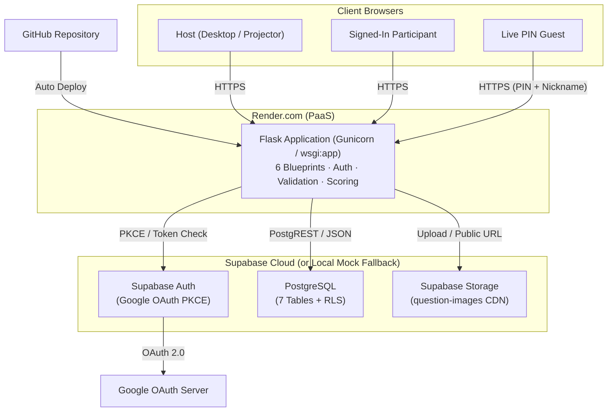
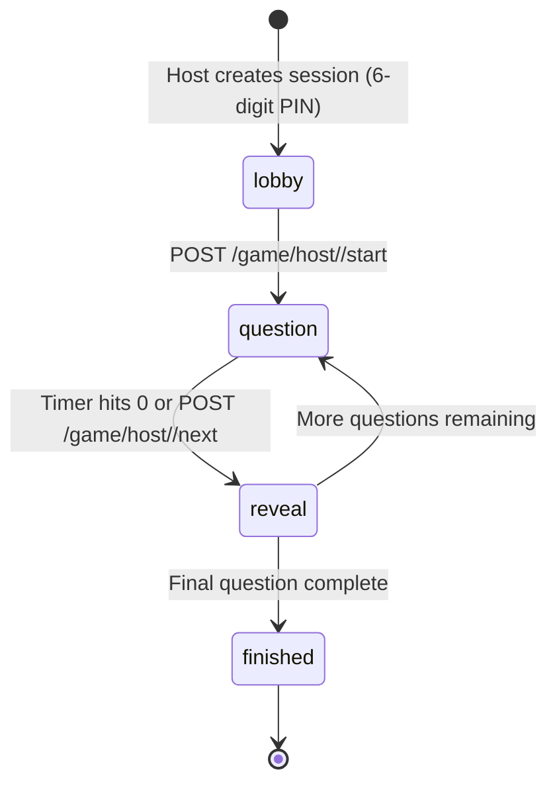
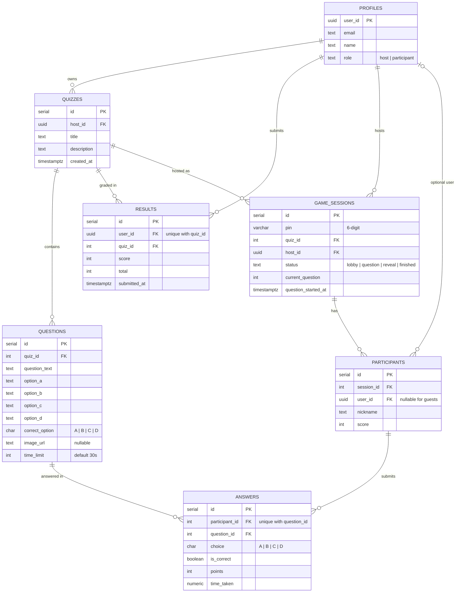

<div align="center">
  
  <h1>QuizLive</h1>
  <p>
    Cloud-based live quiz and result management platform built with Flask, Supabase, Google OAuth 2.0, and Render.
  </p>
  <p>
    <a href="https://quizlive-1.onrender.com">Live App</a> &middot;
    <a href="#features">Features</a> &middot;
    <a href="#cloud-architecture">Architecture</a> &middot;
    <a href="#database-schema">Database Schema</a> &middot;
    <a href="#quick-start">Quick Start</a> &middot;
    <a href="#routes-reference">Routes</a>
  </p>
</div>

---

## Overview

**QuizLive** is a full-stack web application for authoring, hosting, grading, and analyzing online quizzes from any desktop or mobile browser. It unifies two assessment modes on a single codebase and database schema:

- **Self-Paced Mode:** Authenticated participants browse available quizzes, complete assessments once, receive immediate server-side grading, and review a question-by-question answer breakdown.
- **Live Arena Mode:** Hosts generate a unique 6-digit PIN and control question pacing in real time. Players join at `/join` with just a PIN and nickname (no account required), answer with mobile-friendly color-coded tiles, earn speed-bonus points, and finish on a ranked podium.

To support local offline evaluation alongside cloud hosting, QuizLive includes a **dual-mode data layer** ([config.py](config.py), [supabase_client.py](supabase_client.py)): it runs out of the box with zero external setup using a local JSON persistence driver ([mock_supabase.py](mock_supabase.py)) and switches to Supabase Cloud via environment variables.

### User Roles

| Role | Access Method | Capabilities |
|---|---|---|
| **Host** | Google Sign-In (`Host`) or `/switch-role/host` | Create, edit, duplicate, search, and delete quizzes; upload question diagrams; host PIN-based live games; view Chart.js analytics and export CSV results. |
| **Participant (Signed In)** | Google Sign-In (`Participant`) or `/switch-role/participant` | Browse published quizzes, submit self-paced attempts, inspect answer-key breakdowns, and track accuracy/best-score history. |
| **Participant (Live Guest)** | Public `/join` with 6-digit PIN + nickname | Join live multiplayer sessions without an account, submit timed answers, and track live rankings through the podium. |

---

## Features

- **Authentication & Role Control:** Delegated Google OAuth 2.0 via Supabase Auth (PKCE server-side exchange at `/callback` with implicit hash fallback at `/callback/process`), explicit role selection on `/login`, live role switching (`/switch-role/<role>`), automatic `profiles` provisioning, request-scoped user caching on `flask.g`, and `@login_required` / `@host_required` guards.
- **Quiz & Media Management:** Multiple-choice quiz (`A`–`D`) and question CRUD with configurable timers (`5–300s`), one-click quiz duplication (`/quizzes/<id>/duplicate`), live client-side search, and JPG/PNG diagram uploads (`<= 2 MB`) stored in Supabase Storage (`question-images`) or `static/uploads/`. Pre-seeded with 4 quizzes (48 questions) and 11 diagrams in [seeds.py](seeds.py).
- **Self-Paced Grading & Analytics:** Server-side auto-grading, duplicate-attempt locking (`UNIQUE(user_id, quiz_id)`), question-by-question answer review, participant accuracy/best-score summary strip, cross-quiz host overview, theme-aware Chart.js score distributions (`/api/results/<id>`), and downloadable CSV gradebooks (`/dashboard/quiz/<id>/export`).
- **Live Multiplayer Engine:** Unique 6-digit PIN generation, copyable PIN and direct invite URLs, host-controlled round progression, 1.5-second HTTP JSON polling (`game_host.js` / `game_play.js`), speed-weighted scoring, response breakdown counts, and standalone podium view (`/game/<id>/podium`).
- **Security & UI:** PostgreSQL Row-Level Security (RLS) across all 7 tables, `HTTPOnly` / `SameSite=Lax` cookies, regex/length input checks (`NICKNAME_RE`, 2–120 character quiz titles), MIME/size upload checks, server-side masking of `correct_option` until `reveal`, custom `404`/`500` pages, and zero-flicker Light/Dark theme persistence (`localStorage`).

---

## Cloud Architecture

### System Architecture



### Cloud & Application Stack

| Layer | Technology / Service | Model | Role in QuizLive |
|---|---|---|---|
| **Cloud Hosting** | Render.com + Gunicorn (`wsgi:app`) | PaaS | Runs the Flask WSGI server with managed TLS and GitHub auto-deploy |
| **Cloud Database** | Supabase PostgreSQL (`setup_db.sql`) | DBaaS / BaaS | Stores relational quiz, result, and live game data with RLS and 8 indexes |
| **Cloud Identity** | Supabase Auth + Google OAuth 2.0 | Auth / IdP | Passwordless PKCE OAuth login without storing local user passwords |
| **Cloud Storage** | Supabase Storage (`question-images`) | Object Storage | Hosts uploaded JPG/PNG question diagrams; DB stores public CDN URLs |
| **Backend** | Python 3.10+, Flask 3, `python-dotenv`, `supabase-py` | — | Application factory (`app.py`), `smart_url_for` alias resolver, 6 blueprints |
| **Frontend** | HTML5, Jinja2, Bootstrap 5.3, Bootstrap Icons, Chart.js | — | Responsive UI, theme-aware analytics charts, vanilla JS polling controllers |

### Dual-Mode & Dual-Client Design

| | Local Demo Mode (`DEMO_MODE=true`) | Cloud Production Mode (`DEMO_MODE=false`) |
|---|---|---|
| **Database** | In-memory + `local_db.json` (auto-seeded from `seeds.py`) | Supabase PostgreSQL (`setup_db.sql`) |
| **Auth** | One-click `/demo-login` (`host-1`, `student-1`, custom profiles) | Supabase GoTrue + Google OAuth 2.0 |
| **File Storage** | Local disk (`static/uploads/`) | Supabase Storage bucket (`question-images`) |
| **Activation** | Automatic when `SUPABASE_URL` is blank, `DEMO_MODE=true`, or Supabase fails | Set `DEMO_MODE=false` with valid Supabase keys in `.env` |

[supabase_client.py](supabase_client.py) exports two client instances so route handlers remain identical across both modes:
- `supabase` — initialized with `SUPABASE_KEY` (`anon` key) for user token validation and OAuth code exchange.
- `supabase_admin` — initialized with `SUPABASE_SERVICE_KEY` (`service_role` key) for trusted server-side operations (grading, PIN creation, live game updates, and profile upserts).

In Demo Mode, both point to `mock_supabase_client` ([mock_supabase.py](mock_supabase.py)), which implements the same fluent `.table().select().eq().order().execute()` query API on top of `local_db.json`.

### Live Game State Machine

Live sessions are managed by [routes/game_routes.py](routes/game_routes.py) and synchronized every **1,500 ms** by [static/js/game_host.js](static/js/game_host.js) and [static/js/game_play.js](static/js/game_play.js):



- **Speed-Based Scoring:** Correct answers award `max(100, round(1000 - time_taken * 100))` points, where `time_taken` is calculated server-side from `question_started_at`. Wrong answers score `0`.
- **Anti-Cheat Enforcement:** `/game/play/<session_id>/state` omits `correct_option` while `status == "question"`, exposing it only in `reveal` and `finished`. Duplicate answers per `(participant_id, question_id)` return HTTP `409`.

---

## Database Schema

Defined in [setup_db.sql](setup_db.sql) with 7 relational tables, 8 indexes, `ON DELETE CASCADE` rules, Row-Level Security (RLS) policies on every table, and the `question-images` storage bucket:



> **Optional Cloud Column:** `play_routes.submit_quiz()` attempts to persist a per-question `answers` JSON map on `results` (and falls back cleanly if the column is absent). To store per-question breakdowns in PostgreSQL, run:
> ```sql
> ALTER TABLE public.results ADD COLUMN IF NOT EXISTS answers JSONB DEFAULT '{}'::jsonb;
> ```

---

## Project Structure

```text
quizlive/
├── app.py                   # Flask app factory, blueprint registration, smart_url_for, 404/500 handlers
├── wsgi.py                  # Production WSGI entrypoint (Gunicorn)
├── config.py                # .env loading, DEMO_MODE toggle, image upload limits (2 MB JPG/PNG)
├── auth.py                  # get_current_user() with Flask g cache, @login_required, @host_required
├── supabase_client.py       # Cloud vs. local mock client switcher
├── mock_supabase.py         # Local JSON relational store, MockAuth, LocalStorageBucket
├── seeds.py                 # 4 seed quizzes, 48 questions, demo profiles, sample results
├── local_db.json            # Local persistent database for Demo Mode
├── setup_db.sql             # PostgreSQL tables, indexes, RLS policies, and Storage bucket
├── test_features.py         # Automated 7-suite verification script
├── requirements.txt         # Flask, python-dotenv, supabase, gunicorn
├── LICENSE                  # GNU General Public License v3.0
├── routes/
│   ├── main_routes.py       # / and /join
│   ├── auth_routes.py       # /login, /demo-login, /switch-role/<role>, /callback, /callback/process, /logout
│   ├── dashboard_routes.py  # /dashboard, /results, /dashboard/quiz/<id>, CSV export, /api/results/<id>
│   ├── quiz_routes.py       # Quiz/question CRUD, duplication, image upload/deletion
│   ├── play_routes.py       # Self-paced quiz browsing, taking, and server-side grading
│   └── game_routes.py       # Live game creation, host controls, player join, polling, podium
├── static/
│   ├── css/style.css        # Theme variables (light/dark), colored answer tiles, podium layout
│   ├── img/                 # logo-mark.svg, logo.svg, favicon.svg
│   ├── js/                  # game_host.js, game_play.js
│   └── uploads/             # 11 pre-seeded diagrams & local image uploads
└── templates/
    ├── base.html            # Shared navbar, Light/Dark toggle, role switcher, flash alerts
    ├── landing.html         # Hero 6-digit PIN bar and workflow summary
    ├── login.html           # Host / Participant sign-in selector
    ├── demo_login.html      # One-click demo accounts and custom profile login
    ├── callback.html        # Client-side OAuth hash token processor
    ├── errors/              # 404.html, 500.html
    ├── host/                # dashboard, quizzes, quiz_form, quiz_edit, results, quiz_results
    ├── participant/         # dashboard, browse, take_quiz, result
    └── game/                # join, host_control, play, podium
```

On Windows, `../Open_QuizLive.bat` in the parent directory can also be used to start the local server on port `5000` and open `http://127.0.0.1:5000`.

---

## Quick Start

### 1. Install Dependencies

Requires Python 3.10+.

```bash
cd quizlive
python -m venv .venv

# Windows (PowerShell)
.venv\Scripts\Activate.ps1
# macOS / Linux
# source .venv/bin/activate

pip install -r requirements.txt
```

### 2. Run Locally (Demo Mode)

With no Supabase credentials set (or `DEMO_MODE=true`), QuizLive boots directly against `local_db.json`:

```bash
python app.py
```

Open `http://127.0.0.1:5000`.

### 3. Configure Cloud Mode (Supabase + Google OAuth)

Create `quizlive/.env`:

```env
FLASK_SECRET_KEY=replace-with-a-random-secret
SUPABASE_URL=https://your-project-ref.supabase.co
SUPABASE_KEY=your-supabase-anon-key
SUPABASE_SERVICE_KEY=your-supabase-service-role-key
SITE_URL=http://127.0.0.1:5000
DEMO_MODE=false
```

1. Execute [setup_db.sql](setup_db.sql) in the **Supabase SQL Editor**.
2. In **Google Cloud Console**, configure an OAuth 2.0 Web Client with Supabase's callback (`https://<project-ref>.supabase.co/auth/v1/callback`) and enable **Google** under **Supabase → Authentication → Providers**.
3. Add `<SITE_URL>/callback` under **Supabase → Authentication → URL Configuration → Redirect URLs**.
4. Start locally (`python app.py`) or with Gunicorn:

```bash
gunicorn wsgi:app
```

### 4. Deploy to Render.com

- **Root Directory:** `quizlive`
- **Build Command:** `pip install -r requirements.txt`
- **Start Command:** `gunicorn wsgi:app -w 2 -b 0.0.0.0:$PORT`
- **Environment Variables:** `FLASK_SECRET_KEY`, `SUPABASE_URL`, `SUPABASE_KEY`, `SUPABASE_SERVICE_KEY`, `SITE_URL=https://<your-app>.onrender.com`, `DEMO_MODE=false`

---

## Routes Reference

<details>
<summary><strong>Main &amp; Authentication</strong> (<code>main_routes.py</code>, <code>auth_routes.py</code>)</summary>

| Method | Path | Access | Description |
|---|---|---|---|
| `GET` | `/` | Public | Landing page, or redirects signed-in users to `/dashboard` |
| `GET` | `/join` | Public | PIN + nickname entry page for live games |
| `GET` | `/login` | Public | Role selection screen, or starts Demo/Google OAuth when `?role=host\|participant` |
| `GET, POST` | `/demo-login` | Public | Instant sign-in for demo or custom profiles |
| `GET` | `/switch-role/<role>` | User | Switches user role between `host` and `participant` |
| `GET` | `/callback` | Public | PKCE code exchange or renders `callback.html` |
| `POST` | `/callback/process` | Public | Stores client-side OAuth hash tokens in the Flask session |
| `GET` | `/logout` | Public | Clears the Flask session |

</details>

<details>
<summary><strong>Host Quiz Management &amp; Analytics</strong> (<code>quiz_routes.py</code>, <code>dashboard_routes.py</code>)</summary>

| Method | Path | Access | Description |
|---|---|---|---|
| `GET` | `/dashboard` | `@login_required` | Role-aware Host or Participant dashboard |
| `GET` | `/quizzes` | `@host_required` | List host's quizzes |
| `GET, POST` | `/quizzes/new` | `@host_required` | Render create-quiz form or create quiz |
| `POST` | `/quizzes` | `@host_required` | Create quiz and redirect to editor |
| `GET` | `/quizzes/<quiz_id>/edit` | `@host_required` | Edit quiz metadata and questions |
| `POST` | `/quizzes/<quiz_id>/update` | `@host_required` | Update quiz title and description |
| `POST` | `/quizzes/<quiz_id>/delete` | `@host_required` | Delete quiz, questions, and associated images |
| `POST` | `/quizzes/<quiz_id>/duplicate` | `@host_required` | Clone quiz and all questions |
| `POST` | `/quizzes/<quiz_id>/questions` | `@host_required` | Add question with optional image (JPG/PNG, `<= 2 MB`) |
| `POST` | `/questions/<question_id>/update` | `@host_required` | Update question or replace/remove image |
| `POST` | `/questions/<question_id>/delete` | `@host_required` | Delete question and attached image |
| `GET` | `/results`, `/dashboard/results` | `@host_required` | Cross-quiz attempts, sessions, and average scores |
| `GET` | `/dashboard/quiz/<quiz_id>` | `@host_required` | Chart.js score distribution, self-paced results, and live standings |
| `GET` | `/dashboard/quiz/<quiz_id>/export` | `@host_required` | Download self-paced attempts as CSV |
| `GET` | `/api/results/<quiz_id>` | `@host_required` | JSON `{ labels, scores, totals }` for Chart.js |

</details>

<details>
<summary><strong>Self-Paced Play &amp; Live Arena</strong> (<code>play_routes.py</code>, <code>game_routes.py</code>)</summary>

| Method | Path | Access | Description |
|---|---|---|---|
| `GET` | `/play` | `@login_required` | Browse quizzes with at least 1 question |
| `GET` | `/play/<quiz_id>` | `@login_required` | Take quiz, or display graded breakdown if already submitted |
| `POST` | `/play/<quiz_id>/submit` | `@login_required` | Grade answers server-side and block duplicate submissions |
| `GET, POST` | `/game/create/<quiz_id>` | `@host_required` | Generate unique 6-digit PIN and open lobby |
| `GET` | `/game/host/<session_id>` | `@host_required` | Render Host Control screen |
| `POST` | `/game/host/<session_id>/start` | `@host_required` | Transition `lobby` -> `question` |
| `POST` | `/game/host/<session_id>/next` | `@host_required` | Advance `question` -> `reveal` -> next question or `finished` |
| `GET` | `/game/host/<session_id>/state` | `@host_required` | Host polling JSON (question, timer, answer breakdown, top 10) |
| `POST` | `/game/join` | Public | Validate PIN + nickname and create participant session |
| `GET` | `/game/play/<session_id>` | Player Session | Render Player Arena screen |
| `POST` | `/game/play/<session_id>/answer` | Player Session | Submit choice (`A`–`D`) and award speed-bonus points |
| `GET` | `/game/play/<session_id>/state` | Player Session | Player polling JSON (`correct_option` hidden during `question`) |
| `GET` | `/game/<session_id>/podium` | Public | Render standalone final standings podium |

</details>

---

## Testing

Run the automated verification script in Demo Mode (runs against a temporary copy of `local_db.json` without mutating local data):

```bash
cd quizlive
python test_features.py
```

Verifies all 7 functional areas end-to-end:
1. Authentication, unauthenticated redirects, and Host/Participant RBAC
2. Quiz & question CRUD lifecycle
3. Multipart PNG upload and `/static/uploads/` rendering
4. Self-paced auto-grading and duplicate-submission blocking
5. Participant result history, host analytics, and `/api/results/<quiz_id>` JSON
6. Live game flow (PIN generation, lobby join, question round, speed scoring, reveal, finished)
7. Input validation (6-digit PIN format, nickname regex, required question fields)

---

## Known Issues

1. **Host dashboard recent quizzes:** `templates/host/dashboard.html` checks `recent_quizzes`, whereas `routes/dashboard_routes.py` passes `quizzes`, so the Recent Quizzes list renders empty.
2. **Chart.js `max_score`:** `templates/host/quiz_results.html` reads `data.max_score || 1`, while `/api/results/<quiz_id>` returns only `labels`, `scores`, and `totals`.
3. **Browse card metadata:** `templates/participant/browse.html` expects `host_name`, `completed`, and `user_score`, which `play_routes.browse()` does not attach.
4. **Live answer breakdown scoping:** `host_state()` in `routes/game_routes.py` filters `answers` by `question_id` without scoping to `session_id` participants, so re-hosting the same quiz mixes previous sessions' answers into the count.
5. **Cloud SQL schema alignment:** `setup_db.sql` omits `results.answers` (handled via fallback in `play_routes.submit_quiz()`) and `game_sessions.created_at` (referenced in `quiz_results.html`).
6. **Player reveal refresh & rank > 5:** `player_state()` caps `leaderboard` at `top_n=5` (ranks 6+ show `#—`), and `game_play.js` stores `lastAnswerResult` only in client memory (refreshing during `reveal` displays `"Time's Up!"`).

---

## License

[GNU General Public License v3.0](LICENSE)
